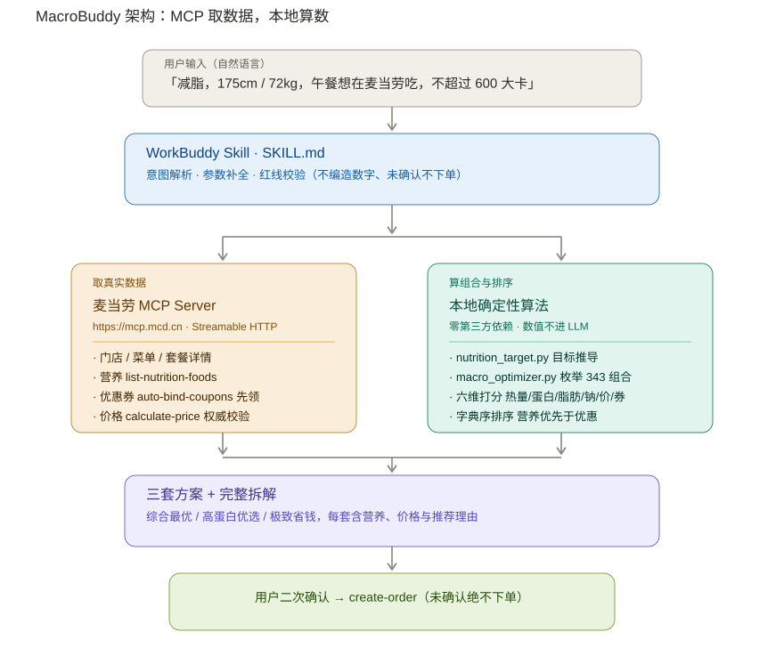

# MacroBuddy · 麦麦宏量搭子

> 减脂期、增肌期、控糖期，都能在麦当劳安心点单。
> 基于麦当劳 MCP 的「**营养 × 预算 × 优惠**」三约束点单决策助手。

`WorkBuddy Skill` · `麦当劳 MCP` · `零第三方依赖` · `算法可复现`

---

## 一、先说三个真实场景

**场景 A｜减脂第 3 周，加班到 21 点，楼下只有麦当劳。**
你知道巨无霸 550 kcal，但不知道"巨无霸 + 玉米杯 + 零度可乐"才 640 kcal 且能凑齐 28 g 蛋白质。
你凭感觉点了个套餐，回家一算超了 400 kcal。**——不是自律问题，是信息问题。**

**场景 B｜你在攒蛋白质，一天要 130 g。**
板烧鸡腿堡 24 g、麦乐鸡 14 g、纯牛奶 7 g……哪些组合能在不超脂肪的前提下把蛋白质拉满？
手工枚举 343 种组合不现实。**——这是需要穷举的优化问题，不该由人脑硬算。**

**场景 C｜账户里躺着 4 张券，你从来没用对过。**
"满 30 减 5"和"巨无霸 8 折（最高减 6）"同时能用，哪个更划算？叠加吗？
更关键的是——**还有 3 张券你根本没领。** 任何基于"现有券"报价的工具，都会算贵。
**——先领券再报价，是报价可信的前提。**

MacroBuddy 就是把这三件事一次性做掉的工具。

---

## 二、它和"帮我推荐个套餐"有什么不同

| 维度 | 常见推荐型工具 | MacroBuddy |
|---|---|---|
| 决策依据 | 价格 / 销量 / 口味 | **热量、蛋白质、脂肪、钠、价格、优惠券 六维联合打分** |
| 数值来源 | 由 LLM 估算 | **MCP 实时取数 + 本地纯函数计算，LLM 不参与算术** |
| 优惠处理 | 基于账户现有券 | **先调 `auto-bind-coupons` 领全券，再报价** |
| 输出 | 一个"推荐" | **三套方案**：综合最优 / 高蛋白优选 / 极致省钱，附带各自代价 |
| 可解释性 | "我觉得这个不错" | 每个方案的每条扣分项都可列出 |
| 可验证性 | 无法复现 | 内置 9 条自测 + 离线 demo，`python3 scripts/selftest.py` 即可验证 |
| 无 Token 能否用 | 不能 | **能**，内置示例数据跑通全链路 |

---

## 三、30 秒上手

### 第 1 步：申请麦当劳 MCP Token

访问 <https://open.mcd.cn/mcp> → 右上角【登录】→ 手机号验证码登录 → 点【控制台】→【激活】
→ 同意服务协议 → 复制 Token。

### 第 2 步：在 WorkBuddy 中配置连接器

左侧边栏【专家·技能·连接器】→【连接器】→ 右上角【自定义连接器】→【配置 MCP】，
粘贴 `mcp-config.example.json` 的内容，把 `${MCD_MCP_TOKEN}` 替换成真实 Token：

```json
{
  "mcpServers": {
    "mcd-mcp": {
      "type": "streamablehttp",
      "url": "https://mcp.mcd.cn",
      "headers": { "Authorization": "Bearer ${MCD_MCP_TOKEN}" }
    }
  }
}
```

保存后回到【自定义连接器】将 `mcd-mcp` **启用**。

### 第 3 步：直接把 SKILL.md 交给 WorkBuddy

把本仓库的 `SKILL.md` 作为 Skill 载入，然后正常说话即可：

> 我 175cm / 72kg，减脂，今天午餐想在麦当劳吃，别超过 600 大卡，帮我搭配一下。

---

## 四、真实输出（非手工修饰）

以下输出由 `python3 scripts/demo_offline.py` 实际执行产生，数据源为仓库内置示例菜单：

```text
[2] 每日宏量目标
    BMR 1669 kcal｜TDEE 2294 kcal｜目标(减脂) 1836 kcal｜蛋白 130 g｜脂肪 51 g｜碳水 215 g｜钠上限 2000 mg

[3] 午餐目标
    热量 612 kcal（可接受 551-649）｜蛋白 43 g｜脂肪 17 g｜碳水 72 g｜钠 667 mg

[4] 搜索空间
    枚举组合 343 个，其中热量落在目标带内 51 个

[5] 推荐方案
    定位      组合                    kcal  蛋白g  脂肪g   钠mg    原价    实付
    ------------------------------------------------------------------------
    综合最优  板烧鸡腿堡 + 橙汁          580    25    18    905    34.0   29.0
    高蛋白优选 双层吉士汉堡 + 纯牛奶       570    32    27    950    32.0   27.0
    极致省钱  吉士汉堡 + 薯条(中)        640    19    30    950    26.0   22.0
```

注意第一行结论有多反直觉：**在减脂目标下，最优解不是套餐，而是「主食 + 饮品」两件套。**
因为套餐多出来的那份薯条会把脂肪顶穿上限，而套餐价省下的 9.5 元，
抵不过脂肪超标带来的代价。这正是需要算法才能算清的部分。

---

## 五、工作原理



核心是一条**职责分离**的分界线：

```
麦当劳 MCP  ──取真实数据──▶  归一化  ──▶  本地确定性算法  ──▶  方案 + 理由
（菜单/营养/券/价）                        （枚举/比价/打分）
                    ▲                                    │
                    └──────── calculate-price 交叉校验 ───┘
```

### 为什么不让 LLM 算数

如果让大模型"看着菜单算热量"，会同时踩三个坑：

1. **算错**。多步加法与百分比比较是大模型的弱项，误差会直接变成用户的执行偏差。
2. **没法解释**。方案错了，你无法定位是哪一步算错。
3. **没法回归**。同一份输入两次结果可能不同，无法写测试。

所以本 Skill 把算术全部下沉到 `scripts/` 下的纯函数：**同样的输入必然得到同样的输出**，
并且每个方案的扣分来源都能逐条打印。LLM 只做两件事：把话听懂、把结果说明白。

### 关键流程：先领券，再报价

优化链路的第一步是 `auto-bind-coupons`（无参数，自动领取全部可领券），
之后才读取券列表并报价。这个顺序是刻意的——见 MCP_INTEGRATION.md 第 3 节。

### 关键决策：营养达标优先于优惠力度

排序采用**字典序**：先按"热量是否落在目标带内"分档，再按综合分排序。
这意味着**再大的优惠也无法把一个明显偏离营养目标的方案顶到推荐位**。
这是本作品的产品立场：你来找我，是为了守住目标，不是为了多省两块钱。

---

## 六、MCP 能力覆盖

| 类别 | 使用的 Tool |
|---|---|
| 时间上下文 | `now-time-info` |
| 门店 | `query-nearby-stores`、`delivery-query-stores`、`delivery-query-addresses`、`delivery-create-address` |
| 菜单与营养 | `query-meals`、`query-meal-detail`、`list-nutrition-foods` |
| 优惠券 | `auto-bind-coupons`、`query-my-coupons`、`query-store-coupons` |
| 价格与交易 | `calculate-price`、`create-order`、`cancel-order`、`query-order`、`order-list` |

完整调用说明见 [MCP_INTEGRATION.md](MCP_INTEGRATION.md)。

---

## 七、目录结构

```
macrobuddy/
├── README.md                    项目介绍（本文件）
├── CONTEST_DECLARATION.md       参赛声明（官方原文，未作任何修改）
├── MCP_INTEGRATION.md           MCP 接入说明（Server / Tool / 流程 / 价值）
├── mcp-config.example.json      MCP 配置示例（仅环境变量占位符）
├── workbuddy.md                 使用 WorkBuddy 开发的对话上下文
├── SKILL.md                     Skill 主入口：红线、工作流、输出模板
├── LICENSE                      MIT
├── scripts/
│   ├── nutrition_target.py      BMR/TDEE → 每日宏量目标 → 单餐目标
│   ├── macro_optimizer.py       组合枚举 / 套餐价判定 / 券择优 / 多目标打分
│   ├── demo_offline.py          无 Token 全链路演示（含 --json）
│   └── selftest.py              9 条自测用例
├── references/
│   ├── mcp-tools.md             MCP 工具契约与错误处理
│   ├── nutrition-model.md       营养模型公式与出处
│   └── scoring.md               打分函数与权重调参说明
├── examples/
│   └── sample_menu.json         示例菜单（非官方实时数据）
└── assets/
    ├── architecture.svg         架构图
    └── demo-output.md           离线运行结果存档
```

---

## 八、本地验证（无需 Token）

```bash
git clone https://github.com/songhting/macrobuddy.git
cd macrobuddy

# 跑自测：9 条用例覆盖公式、边界、券规则、优化器全链路
python3 scripts/selftest.py

# 跑完整演示：输出上方的推荐方案
python3 scripts/demo_offline.py

# 换一个目标看看差异
python3 scripts/demo_offline.py --goal bulk --weight 80 --activity moderate
python3 scripts/demo_offline.py --goal cut --meals 3 --index 1 --json
```

仅依赖 Python 标准库，**无需 pip install**。要求 Python 3.8+。

---

## 九、常见问题

**Q：热量目标是怎么算出来的，可信吗？**
BMR 用 Mifflin-St Jeor 公式，叠加活动系数得到 TDEE，再按目标做 -20%/0%/+10% 调整；
蛋白质按 1.4-1.8 g/kg 体重取值。公式与出处见 `references/nutrition-model.md`。
这是通用区间估算，不是医学建议。

**Q：为什么推荐里没有套餐？**
因为在本例的减脂目标下，套餐附加的薯条会把脂肪顶穿上限，得不偿失。
你可以在对话中直接说"我想要套餐"，Skill 会尊重你的选择并说明代价。

**Q：示例菜单的营养数据准确吗？**
`examples/sample_menu.json` 是用于离线验证算法的**近似示例数据**，非官方数据。
实际运行时所有数值都来自 MCP 实时返回。

**Q：会不会自动帮我下单？**
不会。任何创建订单的动作都需要你明确确认，确认前会复述门店、餐品和实付金额。

**Q：能用在其他快餐品牌吗？**
可以。`scripts/` 下的模块不依赖任何 MCP 细节，替换菜单数据源即可迁移。

---

## 十、参赛信息

本项目为 **2026 麦当劳程序员创意开发大赛**参赛作品，基于麦当劳 MCP 能力开发，
非麦当劳官方产品。项目输出仅供参考，不构成医疗、营养或其他专业建议；
餐品信息、价格及供应状态以麦当劳官方渠道的实时结果为准。详见 [CONTEST_DECLARATION.md](CONTEST_DECLARATION.md)。

使用 [WorkBuddy](https://www.workbuddy.cn/) 完成创意构思、开发与调试。

## 许可

[MIT](LICENSE)
